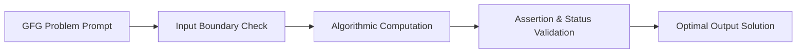

<p align="center">
  
</p>

<p align="center">
  
  
  
  
  
</p>

---

## Executive Summary / Overview
### Problem Statement & Context
Coding interview benchmarks and competitive programming assessments test a developer's ability to navigate edge cases, avoid boundary faults, and craft optimal algorithmic routines under tight memory and runtime constraints.

### Solution Overview
This repository houses curated algorithmic practice problems from the **GeeksforGeeks** platform solved in Python. It documents systematic logic validation, boundary condition testing, status assertions, and clean functional programming patterns.

---

## Interactive Table of Contents
- [Executive Summary / Overview](#executive-summary--overview)
- [Key Features & Capabilities](#key-features--capabilities)
- [System Architecture / Pipeline](#system-architecture--pipeline)
- [Tech Stack Breakdown](#tech-stack-breakdown)
- [Reproducible Quickstart & Setup](#reproducible-quickstart--setup)
- [Project Directory Layout](#project-directory-layout)
- [Author & Contributions](#author--contributions)

---

## Key Features & Capabilities
- **Edge-Case Validation:** Formulates test suites specifically addressing null, zero, negative, and extreme input constraints.
- **State Assertion:** Integrates programmatic checks to verify intermediate variable states during algorithmic execution.
- **Clean Idiomatic Code:** Employs standard Python conventions for readability and performance.
- **Reproducible Verification:** Organized within interactive Jupyter Notebooks for instant step-by-step verification.

---

## System Architecture / Pipeline


---

## Tech Stack Breakdown
| Layer | Technology | Purpose |
| :--- | :--- | :--- |
| **Languages** | Python 3.10+ | Algorithmic logic and data structures |
| **Libraries** | Python Standard Library | Built-in arithmetic and assertion tools |
| **Tools** | Jupyter Notebook, GeeksforGeeks Platform | Interactive problem validation and benchmarking |
| **Architecture** | Procedural / Functional | Pure functions and verified state mutations |

---

## Reproducible Quickstart & Setup
```bash
# 1. Clone repository
git clone https://github.com/suryateja-155/geeks-for-geeks-python-practice.git
cd geeks-for-geeks-python-practice

# 2. Virtual environment setup
python -m venv venv
.\venv\Scripts\activate   # On Windows

# 3. Install Jupyter
pip install notebook

# 4. Open notebook
jupyter notebook "check the status.ipynb"
```

---

## Project Directory Layout
```text
geeks-for-geeks-python-practice/
├── check the status.ipynb   # Status verification and algorithmic check problem
└── README.md                # Solution architecture and algorithmic guide
```

---

## Author & Contributions

**Gettupalli Surya Teja**  
- GitHub Profile: [@suryateja-155](https://github.com/suryateja-155)  
- Portfolio Index: [Gettupalli-Surya-Teja](https://github.com/suryateja-155/Gettupalli-Surya-Teja)

Contributions, issue reports, and feedback are always welcome! Feel free to open an issue or pull request.

<p align="center">
  
</p>
